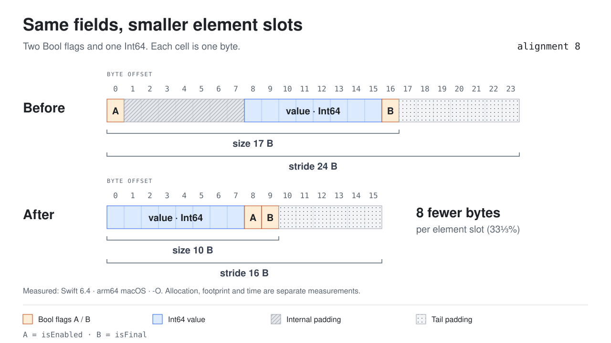

# Swift Struct Layout Skill

An AI agent skill for reviewing and optimizing the memory layout of native Swift structs.

Use it to review one type, find promising candidates across a module, or investigate a large buffer of values. Start with a source-only review, then measure the candidates that matter. When you ask for an optimization, the agent checks compatibility, makes a minimal change, and verifies the result.

## Contents

- [Background](#background)
- [Philosophy](#philosophy)
- [Features](#features)
- [Installation](#installation)
- [Usage](#usage)
- [A layout example](#a-layout-example)
- [Project structure](#project-structure)
- [Contributing](#contributing)

## Background

Field order can change how much space a Swift value needs. A small flag between aligned fields can introduce padding that repeats across every element in an array. Across millions of values, a few bytes per slot can become a useful saving.

Choosing a better order takes more than sorting fields by alignment. Nested structs can leave room for the next field in their parent. Wrappers, macros, generics and conditional compilation can change the actual storage. A reorder can also affect initializers, serialization consumers or an already published ABI.

This skill helps an agent decide where layout work is worth doing and what evidence is needed before calling it an improvement. A smaller stride establishes a smaller element slot. Lower process memory and faster execution require their own measurements.

## Philosophy

**Start with a useful review.** Quick reviews and audits read source code without building the project. The result is a ranked list of candidates, the evidence behind them, and the next check that could change the decision.

**Measure the representation that matters.** For a large array, element stride is usually the relevant metric. For an embedded value, reducing its size can improve the parent even when the child's stride stays unchanged.

**Preserve behavior and contracts.** The agent checks published ABI, external formats, initializer references and observable evaluation order before changing storage. Keeping the current code is a valid outcome when a change has little value or would violate a contract.

## Features

| Area | What the skill covers |
|---|---|
| Candidate selection | Individual types, requested module/app audits, actual storage sites, live-count evidence and meaningful memory budgets |
| Layout reasoning | Size, stride, alignment, internal and tail padding, nested values and counterexamples to alignment sorting |
| Actual stored fields | Property wrappers, macros, lazy properties, conditional fields, concrete generic substitutions, Optional and enum representations |
| Compatibility | Frozen ABI, external binary layouts, memberwise initializers, `Type.init`, initialization effects, codecs and reflection |
| Verification | Target-aware probes, bounded candidate comparisons, relevant behavior checks and reuse of compatible build artifacts |
| Performance evidence | Separate claims for element slots, allocations, process footprint and workload timing |

The skill focuses on native Swift value layout. General application profiling, changing field types, switching to a structure-of-arrays design and migrating binary formats require their own justification.

## Installation

Install from this GitHub repository with the [Skills CLI](https://skills.sh/docs/cli):

```sh
npx skills add https://github.com/ivan-magda/swift-struct-layout-skill --skill swift-struct-layout-skill
```

Choose your coding agent when prompted. The installer discovers the skill from the root `SKILL.md`; no provider-specific plugin is required.

A source-only review needs access to your code. Layout measurements need an appropriate Swift toolchain and, where relevant, the target SDK or runtime.

## Usage

Describe the scope, the result you want, and any limits in ordinary language. You do not need to learn a separate command syntax.

> Use swift-struct-layout-skill to review `EventRecord` for padding opportunities. Don't build or change code.

> Do a quick layout audit of the Models module. Prioritize types retained in large arrays and explain what is worth measuring.

> Confirm the layout of these two candidates in our release configuration. Keep production code unchanged.

> Optimize this record's array stride, preserve its behavior, and verify the result.

> Check whether this field reorder improves our event-processing workload on iPhone.

The depth follows the request:

| Request | Result |
|---|---|
| **Review or audit** | Source-grounded hypotheses, priorities, unknowns and a proposed next measurement. No compilation, tests or benchmarks by default |
| **Confirm or optimize layout** | Measurements of the real type in the relevant build. Authorized changes include compatibility and behavior verification |
| **Measure performance** | Evidence for the specified memory or timing metric on a representative workload |

Scope, depth and permission to edit are independent. A review of the whole application can stay source-only. Measuring a type does not by itself authorize changing production code. An explicit optimization request includes the ordinary verification needed to complete it.

If a target is unavailable, the agent reports what it could establish and what remains unverified. A review can also finish with no worthwhile candidates.

## A layout example

The [standalone probe](examples/layout-probe.swift) contains two structs with the same logical fields: two `Bool` flags and an `Int64` value. On the measured target, moving the value before the flags reduces the stride from 24 to 16 bytes.



Each cell is one byte. **Size** spans the value's inline representation, including internal padding. **Stride** is the step between elements in contiguous storage and includes tail rounding.

This example saves **8 bytes per element slot**. At two million elements, the occupied slots would total 32 MB instead of 48 MB. That arithmetic excludes reserved capacity, allocation overhead and referenced storage; it does not establish a reduction in application footprint or an execution-time improvement.

The figure reflects Apple Swift 6.4, Swift language mode 6, `-O`, native arm64 macOS, with compiler-default SDK and target. It illustrates these declarations in that build. Follow the [measurement instructions](references/measurement.md#run-the-supplied-standalone-example) to reproduce it on your toolchain.

For cases where sorting fails or a child's size matters more than its stride, see the [layout guide](references/layout.md).

## Project structure

```text
swift-struct-layout-skill/
├── SKILL.md
├── references/
│   ├── triage.md
│   ├── layout.md
│   ├── compatibility.md
│   └── measurement.md
├── examples/
│   └── layout-probe.swift
└── assets/
    └── struct-layout.svg
```

[SKILL.md](SKILL.md) selects the depth of work and links to the relevant reference. The guides provide [source-only triage](references/triage.md), [layout reasoning](references/layout.md), [compatibility checks](references/compatibility.md) and [measurement methods](references/measurement.md).

## Contributing

Issues and pull requests are welcome. For a layout finding, include the relevant declaration, compiler and target configuration, before/after measurements, and the behavior or contract that must be preserved. For a timing claim, include a reproducible workload and individual samples.

Keep additions focused on guidance that changes an agent's decisions. Prefer primary Swift documentation and reproducible examples over universal size tables or claims inferred from one machine.
